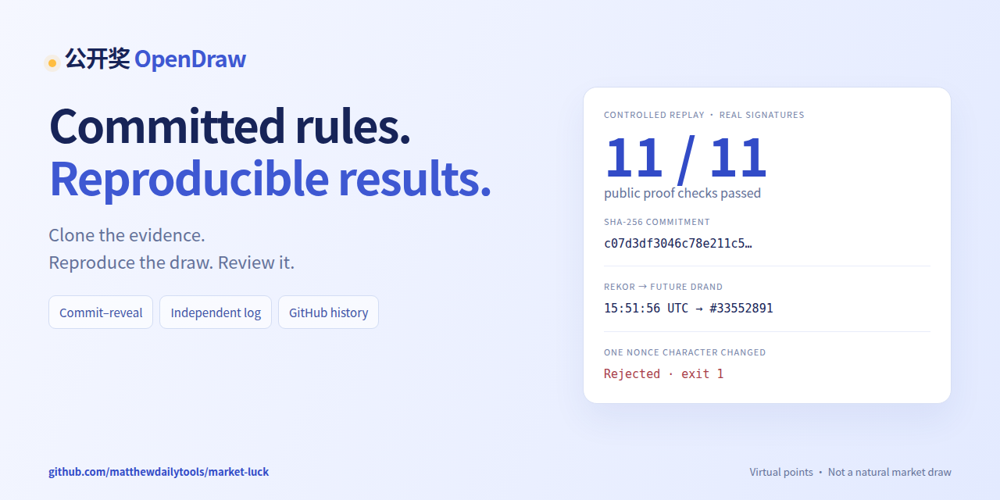

# 公開くじ · OpenDraw

**ルールを先に固定、結果を自分で再計算。** 誰でも公開証拠を独立して検証できる、オープンソースの仮想ポイント抽選です。

[公開検証](https://luck.onlinefreetools.org/verify.html?lang=ja) · [1 分の再計算デモ](https://github.com/matthewdailytools/market-luck/releases/tag/launch-2026-11-01) · [GitHub 公開履歴](history/live/README.md) · [中文](README.md) · [English](README.en.md)

[](https://github.com/matthewdailytools/market-luck/actions/workflows/test.yml) · [MIT](LICENSE) · Node.js 22.13+ · Cloudflare Workers / D1 / R2

[](https://github.com/matthewdailytools/market-luck/releases/tag/launch-2026-11-01)

## API キーなしで再計算

依存関係の導入後はオフライン検証ができます。模擬価格・加速日程・実際の外部署名を使う制御リプレイで、**自然な市場抽選ではありません**。2026-11-01 の初回公開時点で、販売済み LIVE 回は既存 v1 規則を維持します。

```sh
git clone https://github.com/matthewdailytools/market-luck.git
cd market-luck
npm ci
node scripts/verify-proof.js tests/fixtures/v3-controlled-proof.json
```

`VERIFIED` と `ONLINE_REPLAY_SIMULATED_CLOCK` が表示されます。`node scripts/demo-evidence.mjs` は元の証拠の 11 検査と、乱数を 1 文字変更した証拠の拒否・終了コード 1 を実行します。[実行証拠](docs/launch/demo-evidence.json)も保存します。動画は 60 秒で、clone とインストールの待ち時間は含みません。

[60 秒 MP4](https://github.com/matthewdailytools/market-luck/releases/download/launch-2026-11-01/opendraw-one-minute.mp4) · [中文紹介](docs/launch/launch.zh-CN.md) · [English introduction](docs/launch/launch.en.md) · [字幕・画像・制作ソース](docs/launch/README.md)

## 証拠と信頼の境界

新 v3 回は販売前に非公開の銘柄順と 256 ビット乱数を SHA-256 で固定します。MD5 は指紋です。規則と相場固定の Rekor 署名を検証し、指定した未来 drand 回を待って精算と同時に秘密を公開します。既存 v1/v2 規則は変えません。GitHub は公開記録を保存し、固定事実の置換を検知します。

根権限、秘密の非公開、隠れた候補、データ提供元と保存の遅延は引き続き信頼の境界です。[SECURITY.md](SECURITY.md)をご覧ください。公式宝くじや公平性認証ではなく、入出金・現金・実物の賞品はありません。16 か国の番号形式、中国語・英語・日本語 UI を備えます。

導入時は各環境の `ABUSE_IP_KEY` と `COMMIT_ENCRYPTION_KEY`、全 D1 移行が必要です。未公開秘密がある既存鍵は上書きしないでください。[アルゴリズム](ALGORITHM.md)・[API](API.md)・[今回の公開検証報告](公开奖随机承诺与GitHub档案上线验收.md)。

## 実データ版と現在の抽選回

[実データ抽選サイト](https://luck.onlinefreetools.org) · [独立したデモサイト](https://luck-test.onlinefreetools.org) · [LIVE接続・オンライン検証報告](LIVE接入与线上验收.md)

実データ版には、**APIキー不要のYahoo FinanceとNasdaq**を固定した `PUBLIC-NOKEY-v1` を導入済みです。指定取引日の終値が両方から取得でき、正規化した価格が一致することが条件です。**2社中2社の一致が必須**で、欠損・制限・通信障害・不一致があれば待機します。平均値の採用、日付の差し替え、前日の価格への代替は行いません。

現在の回は **2026年11月2日**のAAPL・MSFT・IBMを入力とします。販売終了は `America/New_York` の **03:30**で、04:00のプレマーケット開始より前です。最も早い抽選時刻は通常取引終了の24時間後となります。

| イベント | ニューヨーク時間（EST） | UTC | 北京時間 |
|---|---|---|---|
| 販売終了 | 11月2日03:30 | 11月2日08:30 | **11月2日16:30** |
| 通常取引終了 | 11月2日16:00 | 11月2日21:00 | 11月3日05:00 |
| 最も早い抽選試行 | 11月3日16:00 | 11月3日21:00 | **11月4日05:00** |

日本時間では、販売終了は11月2日17:30、最も早い抽選試行は11月4日06:00です。価格の一致が確認できなければ、さらに待機します。表示時刻ちょうどの抽選完了を保証するものではありません。

サーバーは確認済みの**2026年NYSE/Nasdaq取引日カレンダー**から、`America/New_York` を用いて夏時間・休場日・短縮取引日を含むUTC時刻を算出します。未確認の年は受け付けません。D1も現在のミリ秒時刻で販売終了と抽選可能時刻を検査するため、受付待ち中に締切を越えた購入も拒否されます。公開した実データ回のルールと時刻は後から変更できません。

実時計での事前公開・販売・早期抽選拒否・データベース保護をオンライン検証済みです。購入から正数ポイント配分までの全経路は、実際の過去データを使い、**専用Worker・D1・R2に隔離したリプレイ環境**で検証しました。リプレイの模擬時計は明示されています。将来の11月2日の回が既に自然な時間経過で抽選完了した、という意味ではありません。詳しくは検証報告を参照してください。

## ローカル実行

Node.js 22以上が必要です。

```sh
git clone https://github.com/matthewdailytools/market-luck.git
cd market-luck
npm ci
npm run db:migrate
npm run dev
```

`http://127.0.0.1:8787` を開きます。既定のローカル設定はデモです。デモ回を作成し、登録・番号選択・購入を行い、模擬時計を進めて抽選すると証拠を保存できます。デモ価格は予測可能な固定データで、実データ版とは分離されています。

```sh
npm test
# 開発サーバーの起動中に実行
npm run test:integration
```

## Cloudflareへの設置

`wrangler.live.example.jsonc` を `wrangler.live.jsonc` にコピーします。自分のWorker・D1・R2を用意し、設定内のアカウントID、D1 ID、バケット名、ドメインを置き換えてください。

```sh
cp wrangler.live.example.jsonc wrangler.live.jsonc
npx wrangler login
npx wrangler d1 create market-luck-live
npx wrangler r2 bucket create market-luck-live-evidence
# 自分のリソースIDとドメインを設定してから続行
npx wrangler d1 migrations apply DB --remote --config wrangler.live.jsonc
npx wrangler secret put ADMIN_TOKEN --config wrangler.live.jsonc
npx wrangler deploy --config wrangler.live.jsonc
```

実データ版では `DEMO_MODE=false` を使います。**`PUBLIC-NOKEY-v1` に市場データのAPIキーは不要です。** 自分のGitHubリポジトリは `COMMITMENT_REPOSITORY=owner/repo` で指定します。未指定時は本プロジェクトの既定リポジトリだけが承認されます。管理トークンはWorkers secretsに保存し、画面やGitに含めないでください。

`/api/admin/prepare` で将来の回を準備すると、標準銘柄の対応付けと取引時刻はサーバーが算出します。販売終了は確認済みカレンダーとプレマーケット前の制約に従う必要があります。返されたmanifestの原文バイトを設定済みのGitHubリポジトリへ保存・コミットし、40桁コミットSHAに固定された原文URLを `/api/admin/publish` へ渡します。Workerが原文をダウンロードしてハッシュを確認した後に販売を開きます。確認期間終了後はCronが収集を試行し、管理者は手動collectやpauseも利用できますが、確定済みルールは変更できません。

実データ版・デモ・リプレイは、**別々のWorker・D1・R2**を使ってください。本番は `migrations/` を使用し、**`tests/replay-migrations/` を実データ用データベースへ適用してはいけません。** 実データ版には模擬時計を進めるエンドポイントやリプレイ時計テーブルはありません。

デモを設置する場合は、自分用に `wrangler.test.example.jsonc` をコピーします。`DEMO_MODE=true` と `DEMO_AUTO_DRAW=true` で定期的な模擬抽選を行えます。運営者固有の設置設定はGitの追跡対象外です。

無料の匿名アクセスは、無制限利用・安定稼働・取引所の終局データ・公開再配布権を保証しません。価格修訂や上流データの共有もあり得ます。設置時には適用されるデータ利用権限と運用対策を確認してください。

登録時に1,000ポイントを1回だけ発行します。1口10ポイントで100口分、16形式を各6回試す96口と自由選択4口の予算です。当選や利益は保証しません。

詳細：[アルゴリズム](ALGORITHM.md)、[API](API.md)、[16か国の形式](各国玩法说明.md)、[セキュリティ](SECURITY.md)、[MITライセンス](LICENSE)。

## 検証と任意のAPIキー方式

過去データの診断にはキーを使いません。

```sh
node scripts/check-public-sources.js 2026-10-29 AAPL
```

この診断コマンドは購入や抽選精算を行いません。同じYahoo/Nasdaq方式が、カレンダー・事前公開・時刻制約を追加した実データ回にも接続されています。

`node tests/live-online.js` は実時計で公開・販売を検査し、`LIVE_ADMIN_TOKEN` が必要です。時刻前の抽選は強制できません。`node scripts/run-live-replay.js` は独立したリプレイ設置専用で、`REPLAY_ADMIN_TOKEN` を使います。これらはテストアカウントとチケットを作るため、実行前に検証報告を読んでください。

従来のEODHD・Alpha Vantage・Twelve Dataアダプターは、キーを使用する別方式の評価用に残しています。これらのキーは**現在のYahoo/Nasdaq実データ版の必須条件ではありません**。利用する場合は[任意のAPIキー取得手順](免费行情API申请与配置-逐步操作.md)を参照し、販売開始後に公開済み回のデータソースを差し替えないでください。

詳細：[LIVE接続とオンライン検証](LIVE接入与线上验收.md)、[キー不要の実測](免Key行情源实测.md)、[テーマ設計の評価](主题设计评估.md)。テーマ選定は専門的な設計判断で、ユーザーA/Bテストの結果ではありません。

[魅力・期待感・信頼感の再評価](三主题复评-奖池与开奖结果版.md)でも、新規訪問者の標準は **ポイント体験** です。テーマ指定リンクと保存した選択を優先します。ポイント単位、デスクトップの時刻表示、発表待ちの進捗、スマートフォンの開始導線を改善しました。「抽選を検証」「世界の形式」も3言語で選べます。AIによる設計判断であり、実測のコンバージョン結果ではありません。

ホームに現在の共有ポイントプール、直近の結果、16か国の形式への入口を追加しました。過去の結果はその回で固定したルールを使用し、実際の結果がなければ待機を表示します。デモには明確な表示を付けています。国別の入口はルールと番号選択を開き、購入は行いません。[プールと結果表示の検証記録](首页奖池与开奖结果优化验收.md)を参照してください。

初回ガイドを「登録時に1,000ポイントを1回受領 → 国の形式を選択 → ランダム選択 → 内容を確認して購入」の4段階にしました。選択画面と確認画面に1口10ポイント、現在と購入後の残高、対象回の検証リンクを表示します。ログイン後も有効な番号を保持し、自動購入はしません。通信中断時は元のリクエストキーで照会・再試行し、本人の票と一致してから成功を表示します。[初回体験の検証記録](首次体验与购票流程上线验收.md)を参照してください。

「購入した券」には本人の直近100枚の券番号全文、対象の回、番号、消費ポイントと配分記録を表示します。以前の回は個別に取得し、不足した証拠は未確認のままにして現在のルールを流用しません。券ごとにその回の検証へ移動できます。ログイン後は記録へ戻り、ログアウト時には私的な表示を消去し、古い応答によるアカウント状態の上書きを防ぎます。[券の履歴と状態の検証記録](票据记录与开奖状态优化验收.md)を参照してください。

ブラウザー検証は GitHub Actions の独立した Linux 環境で Chromium / WebKit を動かし、言語・テーマ・画面幅・タッチ操作とスクリーンショットを確認します。Actions → **Ticket browser and mobile acceptance** → **Run workflow** で `online` を有効にすると、使い捨て DEMO アカウントと LIVE の読み取り検証も実行します。ポイント券の作成は DEMO のみで、LIVE API への書き込みはブロックします。[ブラウザーとモバイルの検証報告](我的彩票浏览器与移动端验收.md)を参照してください。

[読みやすい検証ページ](https://luck.onlinefreetools.org/verify.html)で各回のルール、情報源、時系列を確認し、公開後はブラウザーで番号を再計算できます。元のルール・証拠JSONも保存できます。未抽選・模擬・リプレイを区別し、整合性の確認が非公開の情報源や全支払の監査を意味しないことも明示しています。
