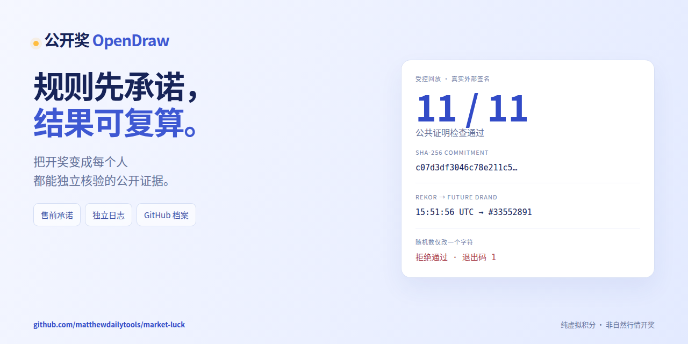
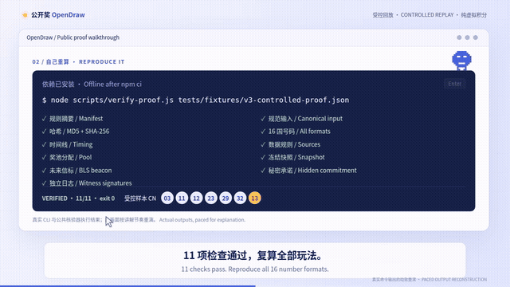

# 公开奖 · OpenDraw

**规则先承诺，结果可复算。** 一个让公众独立检查开奖证据的开源虚拟积分项目。

[看懂本期规则](https://luck.onlinefreetools.org/verify.html) · [一分钟复算演示](https://github.com/matthewdailytools/market-luck/releases/tag/launch-2026-11-01) · [GitHub 核心档案](history/live/README.md) · [English](README.en.md) · [日本語](README.ja.md)

[](https://github.com/matthewdailytools/market-luck/actions/workflows/test.yml) · [MIT](LICENSE) · Node.js 22.13+ · Cloudflare Workers / D1 / R2

[](https://github.com/matthewdailytools/market-luck/releases/tag/launch-2026-11-01)

## 自己重算，无需 API Key

安装依赖后，样本可离线核验。演示包含模拟价格、加速日历与真实外部签名，**不是自然行情开奖**；2026-11-01 首发时已售真实期继续原 v1 规则。

```sh
git clone https://github.com/matthewdailytools/market-luck.git
cd market-luck
npm ci
node scripts/verify-proof.js tests/fixtures/v3-controlled-proof.json
```

预期输出包含 `VERIFIED` 和 `ONLINE_REPLAY_SIMULATED_CLOCK`。再运行 `node scripts/demo-evidence.mjs`：原样本 11 项检查通过；随机数改一个字符后返回 `SECRET_COMMITMENT_MISMATCH`，退出码 1。两次执行结果写入 [演示证据](docs/launch/demo-evidence.json)。一分钟指演示长度，clone 和安装等待时间另计。

[60 秒 MP4](https://github.com/matthewdailytools/market-luck/releases/download/launch-2026-11-01/opendraw-one-minute.mp4) · [中文介绍](docs/launch/launch.zh-CN.md) · [English introduction](docs/launch/launch.en.md) · [字幕、社交图与制作源文件](docs/launch/README.md)

<details>
<summary>展开 12 秒片段：通过核验 → 单字符篡改 → 拒绝</summary>



</details>

## 证据链与信任边界

**售前承诺 → 独立日志 → 指定未来信标 → 揭晓复算 → GitHub 档案。** 新 v3 使用隐藏股票顺序与 256 位随机数，SHA-256 提供安全承诺，MD5 保留作指纹；售前规则和首次行情冻结取得 Rekor 签名见证，验证指定未来 drand 后结算并原子揭晓。v1/v2 已售规则不改。核心算法不把投注内容作为号码生成输入。

GitHub 保存公开核心事实，归档脚本拒绝替换已有固定记录。Worker 不持有归档写入令牌。根权限、拒绝揭晓、隐藏候选、数据源和异步观察延迟仍是边界，见 [SECURITY.md](SECURITY.md)。这是纯虚拟积分项目，没有入金、提现、现金或实物奖品，也不代表官方彩票或机构公平认证。

支持 16 国虚拟号码格式、中英日界面、注册积分、原子购票、滚存奖池、中奖流水和公开证明。[算法](ALGORITHM.md) · [API](API.md) · [真实接入](LIVE接入与线上验收.md) · [v3 与档案上线验收](公开奖随机承诺与GitHub档案上线验收.md) · [传播方案](GitHub传播方案.md)

## 本地运行

需要 Node.js 22.13+（建议使用 22 的最新版本或更新的受支持版本）。

```powershell
npm install
npm run build:crypto
npm run db:migrate
npm run dev
```

访问 http://127.0.0.1:8787 。创建一期 → 注册领 1000 分 → 选号购票 → 模拟全部闭市 → 执行开奖 → 下载复算证据。下一期保留奖池滚存。演示控制仅 localhost 可用。

## 验证

```powershell
npm test
# 保持 dev 服务运行；集成测试会创建测试用户、购票和结算本地演示期
npm run test:integration
```

单测覆盖抽号、行情适配及防作弊约束；集成测试在本地 workerd 使用真实 D1/R2 模拟绑定运行。下载 JSON 中的 input 可复算：MD5(input) 是公开指纹；v1 使用 SHA256(input) 为 seed，v2/v3 分别使用 SHA256("market-luck/draw/v2\n" + input) / SHA256("market-luck/draw/v3\n" + input)。见 [算法](ALGORITHM.md)。不要把模拟行情视作真实随机源，模拟价格可预测。

## 真实行情

当前真实期使用 Yahoo Finance + Nasdaq 免 Key 的 `PUBLIC-NOKEY-v1`，必须两源逐只价格一致，缺失或分歧就等待。详情见[真实接入与验收](LIVE接入与线上验收.md)和[免 Key 实测](免Key行情源实测.md)。另保留 EODHD / Alpha Vantage / Twelve Data 的 Key 适配及[逐步申请说明](免费行情API申请与配置-逐步操作.md)，没有实际 Key 的接口不宣称已完成线上联调。免费可访问不等于获得公开再分发许可。

## Cloudflare 部署准备

当前版本需要配置 `BEACON_VERIFIER` SQLite Durable Object（示例配置已包含绑定与 class migration），并为每个公网安装设置独立的 `ABUSE_IP_KEY` 和 `COMMIT_ENCRYPTION_KEY`。它们分别用于限流 HMAC 与 AES-256-GCM 秘密包加密，不是行情服务 API Key；Rekor 不需账户或 Key。不要将密钥提交仓库或发到聊天中。首次安装时可直接通过管道生成：

```powershell
node -e "process.stdout.write(require('node:crypto').randomBytes(32).toString('hex'))" | npx wrangler secret put ABUSE_IP_KEY --config wrangler.live.jsonc
node -e "process.stdout.write(require('node:crypto').randomBytes(32).toString('hex'))" | npx wrangler secret put COMMIT_ENCRYPTION_KEY --config wrangler.live.jsonc
npm run build:crypto
npx wrangler d1 migrations apply DB --remote --config wrangler.live.jsonc
npx wrangler deploy --config wrangler.live.jsonc
```

DEMO 使用自己的配置与不同密钥。**现有安装先检查 secret 名称；已配置的加密密钥要保留，不要重复执行生成命令覆盖。**未揭晓 v3 期依赖原密钥，丢失或随意轮换会阻止其解密；须以独立受控方式备份并保护密钥。迁移与代码配套发布（包括 `0008_commitment_witnesses.sql`）；旧代码不支持新 v3。部署后访问 `/api/randomness-health` 检查信标/见证验签与保护配置。不要把新规则写回旧 manifest，不要用回滚应用代码来绕过已发布规则。

创建自己的 D1 数据库和 R2 桶，替换 wrangler.jsonc 中的数据库 ID。正式环境将 DEMO_MODE 改为 false，再执行远端迁移和部署：

```powershell
npx wrangler d1 migrations apply DB --remote
npm run deploy
```

不要直接把 DEMO_MODE=true 作为公网生产配置。独立 LIVE 的配置示例、迁移与发布步骤见[真实接入与验收](LIVE接入与线上验收.md)，已接入审核过的 2026 美股交易日历和固定 GitHub 提交中的事前承诺；未审核年份拒绝开期。数据授权、账号防滥用和安全审计仍需独立评估。没有真实 LIVE 期时生产页面保持等待开期，不自动生成模拟行情。

## GitHub 核心数据历史

在自己的 GitHub 仓库启用 Actions 后，手动运行 **Public core record archive** 验证首次归档，再按工作流的计划持续观察。默认写入 `history/live/`；可手动选择独立 DEMO。仓库写入使用单次任务的 `GITHUB_TOKEN`，Worker 无需也不接收该写入令牌。正常未变的轮询不产生提交，替换旧事实会报错。

Fork 部署必须先将仓库变量 `ARCHIVE_LIVE_ORIGIN`、`ARCHIVE_DEMO_ORIGIN` 改为自己的 HTTPS 源站，并将 Worker `COMMITMENT_REPOSITORY` 设置为自己的仓库。公开镜像只保留规则、证据和去除用户标识的积分流水。新期异步归档可能延迟；原售前提交、Rekor 签名时间和镜像提交时间分别核对。详见 [存储方案](GitHub核心档案存储方案.md)和 [API](API.md#public-github-history)。

## 项目文档

- [用户痛点研究与三个宣传主题](彩票用户痛点与主题策略.md)
- [三主题吸引力、信任感及默认选择](三主题吸引力与信任感评估.md)
- [可读核验页版主题复评（历史）](三主题复评-可读核验页版.md)
- [奖池与开奖结果版三主题复评](三主题复评-奖池与开奖结果版.md)
- [宣传主题上线验收](宣传主题上线验收.md)
- [16 国玩法说明](各国玩法说明.md)
- [注册赠分测算与发行机制](注册赠分测算.md)
- [开奖算法规范](ALGORITHM.md)
- [HTTP API](API.md)
- [普通用户核验页](https://luck.onlinefreetools.org/verify.html)：本期规则、来源、时间线与浏览器独立复算，保留原始 JSON 下载
- [公开期次分享卡](https://luck.onlinefreetools.org/share.html)：无需登录，固定期号与玩法，中英日切换、复制链接及保存 PNG；已公布号码须先通过本页复算，明确区分 LIVE、DEMO 和回放。
- [公开分享卡与传播入口上线验收](公开分享卡与传播入口上线验收.md)
- [可读核验页上线验收](可读核验页上线验收.md)
- [行情源配置](行情数据源接入.md)
- [贡献指南](CONTRIBUTING.md) / [安全边界](SECURITY.md) / [MIT 许可证](LICENSE)

注册赠分 1,000 分 = 100 注，用于覆盖 16 种玩法各 6 期（96 注）并留 4 注自由选择。完整概率与通胀测算见报告。网页支持中文、English、日本語。GitHub 开源仓库已创建，包含 MIT 许可证与自动检查工作流。

## Anonymous market-source diagnostics

No API keys are needed to test Yahoo Finance + Nasdaq historical closes: `node scripts/check-public-sources.js 2026-10-29 AAPL`. This command is historical diagnostics; live rounds separately pin `PUBLIC-NOKEY-v1` and future market sessions. See [免 Key 实测](免Key行情源实测.md) and [API Key 逐步申请](免费行情API申请与配置-逐步操作.md). The owner-specific test deployment config is gitignored; copy `wrangler.test.example.jsonc` to `wrangler.test.jsonc` and use your own IDs/domain when creating your own test site.

## LIVE / 真实开奖更新

[真实开奖站](https://luck.onlinefreetools.org) · [LIVE接入与线上验收](LIVE接入与线上验收.md) · [主题设计评估](主题设计评估.md)

Yahoo Finance + Nasdaq 免Key的 PUBLIC-NOKEY-v1 已接入真实期次；2/2价格一致，03:30纽约时间前停售，闭市后24小时才可开奖。生产LIVE与模拟站、线上历史回放安装分离。当前期最早自然开奖为北京时间2026-11-04 05:00。已完成上线售票与提前开奖拒绝，完整派奖闭环在明确标记的隔离回放中验证。详见上面的最新报告；旧文档中尚未启用LIVE的描述是上次交付记录。

首页提供“积分体验”（新访客默认）、“公开核验”“全球玩法”三种主题，支持中文、English、日本語。可用 `?theme=verify`、`?theme=points`、`?theme=world` 分享各主题。[新版三维复评](三主题复评-奖池与开奖结果版.md)比较吸引力、彩票期待感和信任感后继续选择积分默认；显式链接与用户已保存的选择优先。新版本强调积分单位、完整时间、当前进度，并让开始选号与核验路径更清楚。痛点研究见[主题策略](彩票用户痛点与主题策略.md)。评分为 AI 启发式判断，尚无真实用户 A/B 转化结论。

公开核验入口现在进入站内可读页面，原始承诺 JSON 和开奖证明 JSON 放在下载区。尚未开奖时显示等待，开奖后浏览器独立计算 MD5、SHA-256 和各玩法号码，并分别说明数据源、时间与奖池检查的含义边界。

移动端首页将注册赠分、单注成本、停售时间、最早核验时间和核验入口提前，小球装饰缩小并后移；支持三种主题及中英日语言。官网参考、设计取舍与验收记录见[移动端首页优化与官网参考](移动端首页优化与官网参考.md)。

首页进一步突出当前共享积分奖池，并增加最近开奖结果卡及 16 国玩法快捷入口。结果使用各历史期锁定的规则与号码；尚无真实结果时保持等待，演示结果明确标识。国别入口只同步规则和选号，不自动购票。详见[奖池与开奖结果首页验收](首页奖池与开奖结果优化验收.md)。

新用户可按“注册领 1,000 积分 → 选择国家玩法 → 随机选号 → 核对并确认”的四步引导开始。每注 10 积分，选号区与确认窗口同时显示成本、余额和预计扣后余额，并保留本期核验入口；先选号再登录也会保留号码，登录不会自动购票。网络中断后查询或重试原请求，核对私有票据后才显示成功。详见[首次体验与购票流程验收](首次体验与购票流程上线验收.md)。

独立的“我的彩票”显示本人最近 100 张票的完整票号、所属期次、号码、成本与派奖记录。超出首页最近 20 期的票据会补查其原期次，缺失数据保留“待核实”，不套用当前规则；每张票可直达该期核验。从票据区登录会返回记录，退出立即清除私有显示，迟到的旧账号响应不能覆盖新状态。详见[票据记录与开奖状态验收](票据记录与开奖状态优化验收.md)。

浏览器验收使用 GitHub Actions 的隔离 Linux 环境运行 Chromium / WebKit，覆盖多语言、主题、视口与触控交互，并生成截图和测量报告。打开 Actions → **Ticket browser and mobile acceptance** → **Run workflow**，勾选 `online` 可额外测试演示站真实账号流程与正式站只读页面。线上测试只在 DEMO 创建一张积分票；正式站禁止测试写入。详见[浏览器与移动端验收](我的彩票浏览器与移动端验收.md)。
