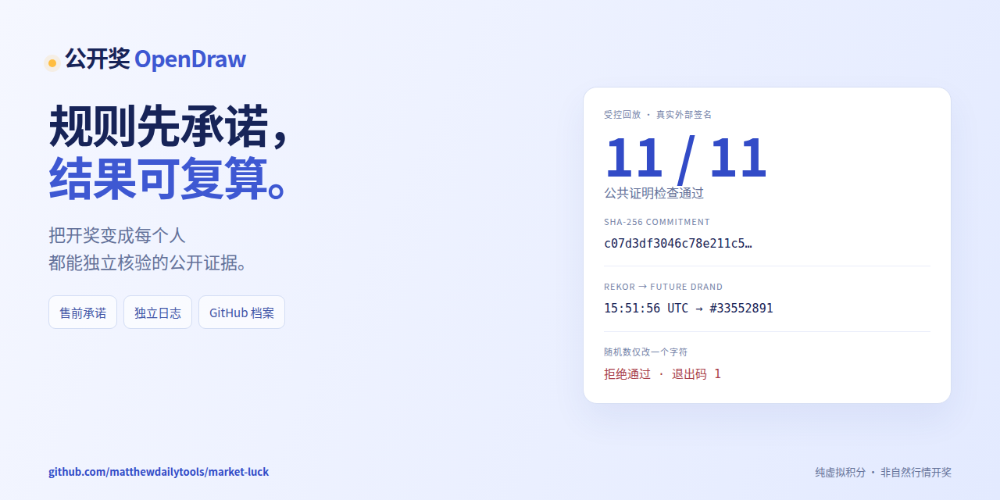

# 公开奖 GitHub 首发材料

[双语首发 Release](https://github.com/matthewdailytools/market-luck/releases/tag/launch-2026-11-01) · [中文正文](launch.zh-CN.md) · [English introduction](launch.en.md)

## 观看与下载

- [一分钟复算 MP4](https://github.com/matthewdailytools/market-luck/releases/download/launch-2026-11-01/opendraw-one-minute.mp4)：60 秒、1280×720、30 fps，H.264/AAC，双语烧录字幕，无旁白。
- [中文 SRT](opendraw-one-minute.zh-CN.srt)、[English SRT](opendraw-one-minute.en.srt)：独立字幕，便于重新配音或无障碍使用。
- [中文社交预览 PNG](social-preview.zh-CN.png)、[English social preview](social-preview.en.png)：1280×640，纯色背景，每张小于 1 MB。
- [12 秒预览 GIF](replay-preview.gif)、[海报](poster.jpg)、[执行证据](demo-evidence.json)、[渲染报告](media-report.json)。



视频是基于**实际 CLI 和公共核验器输出的动效重演**。画面持续标注受控回放；模拟价格、加速日历、真实外部签名与自然市场开奖严格区分。安装依赖的等待不计入一分钟。所有素材均不含私人账户或票据。

## 复算与重建

```sh
npm ci
node scripts/verify-proof.js tests/fixtures/v3-controlled-proof.json
node scripts/demo-evidence.mjs
```

第二条验证原始证据；第三条再次实际运行 CLI，并生成单字符篡改副本验证其被拒绝。原始样本退出码为 0，篡改副本退出码为 1，临时文件自动清理。原始真实期规则、票据和奖池均不被访问或修改。

重建图像和视频需要可使用浏览器的独立环境、Playwright Chromium、ffmpeg 与中文系统字体：

```sh
npx playwright install chromium
sh docs/launch/build.sh
```

输出在 `test-output/launch-media/`。也可在 GitHub Actions 手动运行 **OpenDraw launch media**；取消 `render_video` 只生成社交图、海报、表情表和关键帧。首次静帧验收后再生成完整视频。渲染任务无 GitHub 写权限，不读取应用 secrets，也不连接生产 API。

源码：[时间线](timeline.js)、[画面](media.html)、[动画](media.js)、[渲染器](../../scripts/render-launch.mjs)、[分镜](TREATMENT.md)、[素材许可](CREDITS.md)。成片和音效为本项目原创，第三方字体及制作方法见 Credits；再发布时须确认所用素材的权利。

## GitHub 仓库全局社交预览设置

图像入库、嵌入 README 或添加到 Release **不会自动更改**仓库链接的全局分享卡。本轮制作环境的浏览器工具返回 `Local browser use is disabled in Work settings`，GitHub 官方公开 REST API 未提供这个图片上传操作，因此没有将其标成已设置。

具备仓库管理权限的账号可按 [GitHub 官方步骤](https://docs.github.com/en/repositories/managing-your-repositorys-settings-and-features/customizing-your-repository/customizing-your-repositorys-social-media-preview)完成：

1. 下载上方中文或英文 PNG。
2. 打开[仓库 Settings](https://github.com/matthewdailytools/market-luck/settings)，找到 **Social preview**。
3. 点击 **Edit → Upload an image**，选择 PNG，检查裁切后保存。
4. 分享仓库链接，等待目标社交平台缓存更新。仓库只能配置一张全局图；本项目同时保留中英文素材供其他渠道选择。

无需为此向任何人发送 GitHub 密码或 Token。GitHub 托管、CI 和独立日志不表示平台对公平性的认证。
