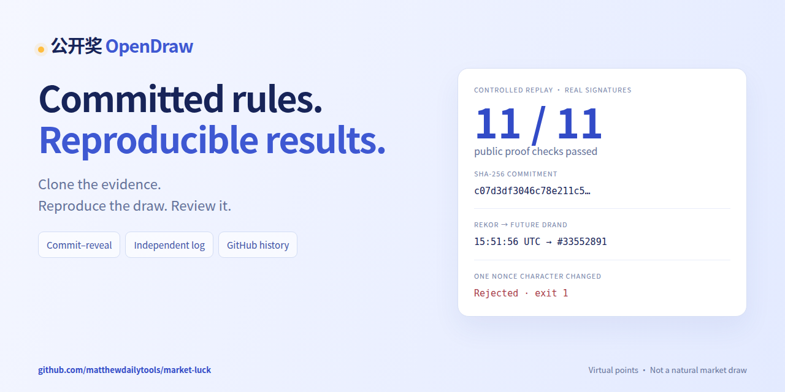

# OpenDraw launch: clone the evidence, reproduce the draw

OpenDraw is an open-source virtual-points draw project. Public rules, randomness inputs, independent log receipts and reproducible proofs let people inspect how a result was produced. There are no deposits, withdrawals or cash prizes. This is not an official national lottery.

**Watch the one-minute walkthrough, then verify the evidence yourself.**

[60-second walkthrough](https://github.com/matthewdailytools/market-luck/releases/download/launch-2026-11-01/opendraw-one-minute.mp4) · [Readable verification](https://luck.onlinefreetools.org/verify.html?lang=en) · [Public GitHub history](https://github.com/matthewdailytools/market-luck/tree/main/history/live)



For new v3 rounds, OpenDraw commits to a hidden stock permutation and 256-bit nonce before sales. SHA-256 provides the binding commitment; MD5 is a compatibility fingerprint. Rules and the first two-source market consensus snapshot receive independently signed Rekor receipts. The freeze witness determines a specific future drand round. After signature verification, settlement and secret disclosure commit atomically.

GitHub archives public core records, while browser and CLI verifiers reproduce the proof. Existing sold rounds retain their original rules; the current archived LIVE round remains v1.

## Reproduce it

Use Node.js 22.13+. Install dependencies once; no market-data account or API key is required, and sample verification then works offline:

```sh
git clone --branch launch-2026-11-01 https://github.com/matthewdailytools/market-luck.git
cd market-luck
npm ci
node scripts/verify-proof.js tests/fixtures/v3-controlled-proof.json
node scripts/demo-evidence.mjs
```

The final command executes the valid proof and a copy with one nonce character changed. The valid proof passes 11 public checks and exits 0. The altered proof reports `SECRET_COMMITMENT_MISMATCH` and exits 1. It writes inspectable evidence without contacting production APIs or user accounts.

The movie is a paced motion reconstruction of those actual outputs, with Chinese and English captions. It uses synthetic prices, an expedited calendar and genuine external Rekor/drand signatures. **It is not a natural market draw.** Clone and dependency-download waiting time is excluded. MP4, both SRT tracks, social images and checksums are attached to this release.

## Review the trust model

Independent reproductions, alternative verifiers and actionable threat-model feedback are welcome. Include the code commit, public fixture or round, environment, command and outcome; omit accounts, cookies, private tickets and credentials.

Root owners can still stop service, withhold reveals or hide candidates. Log inclusion does not prove global candidate uniqueness, and the GitHub observer can lag the future beacon. Hosting and valid signatures are not fairness certification. Use [Issues](https://github.com/matthewdailytools/market-luck/issues) for public feedback; read [SECURITY.md](https://github.com/matthewdailytools/market-luck/blob/main/SECURITY.md) before reporting a vulnerability.

[Algorithm](https://github.com/matthewdailytools/market-luck/blob/main/ALGORITHM.md) · [API](https://github.com/matthewdailytools/market-luck/blob/main/API.md) · [Install](https://github.com/matthewdailytools/market-luck/blob/main/README.en.md#install-locally) · [Media credits](https://github.com/matthewdailytools/market-luck/blob/main/docs/launch/CREDITS.md)
