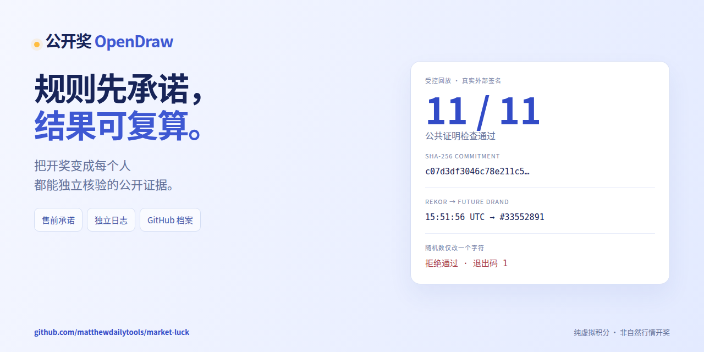

# 公开奖首发：规则先承诺，结果可复算

公开奖（OpenDraw）是一个开源的虚拟积分开奖项目：把规则、随机性输入、独立日志和复算证明公开，让每个人都能检查结果如何产生。没有入金、提现或现金奖品，也不代表任何国家的官方彩票。

**先花一分钟看懂，再运行命令自己检查。**

[观看 60 秒复算演示](https://github.com/matthewdailytools/market-luck/releases/download/launch-2026-11-01/opendraw-one-minute.mp4) · [可读核验页](https://luck.onlinefreetools.org/verify.html) · [GitHub 核心档案](https://github.com/matthewdailytools/market-luck/tree/main/history/live)



新 v3 期的证据链：

1. 售前随机确定隐藏股票顺序和 256 位随机数，公开 MD5 指纹及承担安全承诺的 SHA-256。
2. 规则和首次双源一致的行情冻结，分别取得独立 Rekor 日志的签名见证。
3. 等待由冻结见证时间确定的指定未来 drand 轮次，验证签名后计算号码；结算与揭晓秘密原子提交。
4. GitHub 持续保存公开核心记录；浏览器和 CLI 可独立复算。当前档案中的旧期仍遵守其原 v1 规则。

## 自己重算

需要 Node.js 22.13+。依赖只需安装一次；样本核验无需行情账户或 API Key，安装后可离线运行：

```sh
git clone --branch launch-2026-11-01 https://github.com/matthewdailytools/market-luck.git
cd market-luck
npm ci
node scripts/verify-proof.js tests/fixtures/v3-controlled-proof.json
node scripts/demo-evidence.mjs
```

最后一条命令实际验证两件事：原样本 11 项公共检查通过、CLI 退出码 0；秘密随机数只改一个字符后，返回 `SECRET_COMMITMENT_MISMATCH`、CLI 退出码 1。它会生成可检查的执行证据，不接触真实用户或生产接口。

一分钟视频依据这份实际输出制作动效重演，提供中英文字幕。样本使用模拟价格、加速日历和真实 Rekor/drand 签名；**不是自然行情开奖，也不表示已售真实期采用了新规则。** 视频不包含 clone 或依赖下载的等待时间。MP4、中英文 SRT、两张社交预览图和校验和均在本 Release 附件中。

## 邀请审阅

希望得到独立复算、不同语言的验证器和可复现的威胁模型反馈。提交复算记录时，请注明代码 commit、公开样本/期号、环境、命令和结果；不要提交账户、Cookie、私人票据或凭据。

根权限仍可停服、拒绝揭晓或隐藏候选；Rekor 包含证明不证明候选全局唯一，GitHub 异步镜像可能晚于信标观察到冻结。托管和签名验证不是平台公平认证。公开问题请用 [Issues](https://github.com/matthewdailytools/market-luck/issues)，安全问题先阅读 [SECURITY.md](https://github.com/matthewdailytools/market-luck/blob/main/SECURITY.md)。

[算法](https://github.com/matthewdailytools/market-luck/blob/main/ALGORITHM.md) · [API](https://github.com/matthewdailytools/market-luck/blob/main/API.md) · [部署与安装](https://github.com/matthewdailytools/market-luck#本地运行) · [素材及许可](https://github.com/matthewdailytools/market-luck/blob/main/docs/launch/CREDITS.md)
