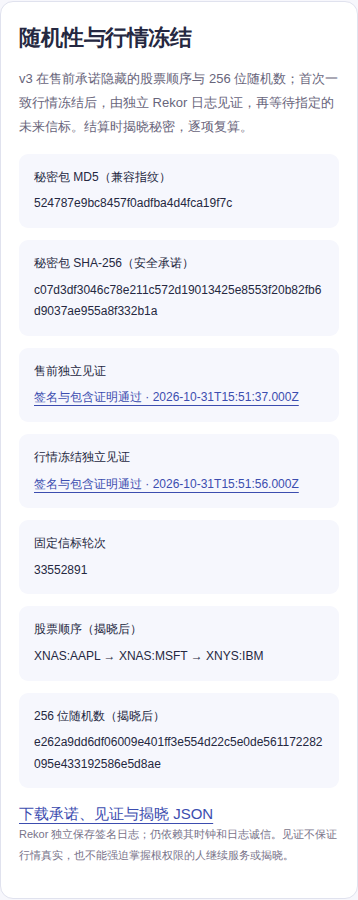

# 公开奖：隐藏承诺、独立见证与 GitHub 核心档案上线验收

2026-11-01，北京时间。站点品牌为“公开奖 / OpenDraw / 公開くじ”，定位“公平机制、公开记录、结果可追溯”。默认首页使用核验主题，保留积分成本、奖池、时间线及 16 国虚拟玩法。

本轮已完成方案、实现、本地与线上测试、Cloudflare 部署及 GitHub 首次真实归档。**没有修改原已售期的规则，也没有提前执行真实开奖。** 新 v3 的自然行情开奖尚未发生；带真实外部签名的受控回放不能代替自然验收。

## 发布与入口

| 项目 | 实际记录 |
|---|---|
| 运行时代码 | [`f2621ea60528d447f528bc1f12f304ffe4bf038c`](https://github.com/matthewdailytools/market-luck/commit/f2621ea60528d447f528bc1f12f304ffe4bf038c) |
| LIVE | [luck.onlinefreetools.org](https://luck.onlinefreetools.org)，Cloudflare 版本 `2ba80cfa-85a4-4bf5-ac5c-f31303a9b312` |
| DEMO | [luck-test.onlinefreetools.org](https://luck-test.onlinefreetools.org)，Cloudflare 版本 `31523ed8-b31e-4a5e-bd6e-499331d689ee` |
| 首次核心档案 | [`7624d7bee3ed6a772e41d8d1cc0f78154705c7e1`](https://github.com/matthewdailytools/market-luck/tree/7624d7bee3ed6a772e41d8d1cc0f78154705c7e1/history/live) |
| 可读核验 | [公开核验页](https://luck.onlinefreetools.org/verify.html)，显示本期规则、时间线、数据源、证据及 GitHub 档案 |
| 传播材料 | [GitHub 传播方案与中英首发草稿](GitHub传播方案.md) |

先于实现保存[隐藏顺序承诺与独立见证改进方案](隐藏顺序承诺与独立见证改进方案.md)，计划提交为 `d8b0f12`。用户补充 GitHub 存储要求后，先保存[GitHub 核心档案存储方案](GitHub核心档案存储方案.md)，再实现；该计划提交为 `8b1142f`。后续报告与工作流配置提交不改变运行时代码或已售 manifest。

## 已实现的证据链

1. 新 v3 草稿由服务端密码学随机数生成完整股票排列和 32 字节随机数。固定 JSON 字节同时计算 MD5 与 SHA-256；MD5 是兼容指纹，SHA-256 才承担安全承诺。外部请求不能指定秘密、顺序或见证。
2. 秘密使用每个安装独立的 AES-256-GCM 密钥加密保存在私有 D1，绑定期号和规则摘要。售前只公开承诺；公开 API 不返回密文存储结构和秘密。
3. 售前规则与首次双源一致的行情冻结分别向独立 Rekor 公共日志取得签名收据。发送前先固定意图字节，重复请求使用相同意图；验证条目签名、日志签名时间、Merkle 包含证明、分片和 checkpoint 签名。
4. 从冻结见证的签名时间确定至少 120 秒后的指定 drand 轮次，并验证固定链的 BLS 签名。缺资料、不一致、日志或信标失败都继续等待，不切换另一份快照或信标来选结果。
5. 结算与秘密揭晓放在同一个 D1 事务中。派奖失败时秘密不被提前公开；成功后浏览器和 CLI 检查承诺、排列、行情、见证、信标、号码及奖池分配。
6. GitHub Actions 从公开 GET API 独立拉取、验证并保存核心记录。Worker 不持有 GitHub 写入令牌；归档任务不持有 Cloudflare 管理令牌。

新增追加迁移 `0008_commitment_witnesses.sql` 已在两站执行，安装分别配置了加密密钥。原 v1/v2 的输入、顺序、种子、停售、派奖及证明解释保留原版本；生产准备接口只创建新 v3，不能用请求参数降级。

本轮还修正了一个关键协议风险：**种子只包含固定见证记录内容的摘要，不能包含会变化的 checkpoint、包含证明或收据排版。** 对同一真实日志叶子获取新 checkpoint 后，种子和结果保持一致。加速回放也不能通过修改标签冒充生产日历开奖。这些修正发生在任何真实 v3 期公开销售之前。

## GitHub 公开历史实际验收

[首次归档运行 41221712436](https://github.com/matthewdailytools/market-luck/actions/runs/41221712436)通过，产生 108 个文件：本期原规则、原售前锚点、当前状态、可读索引及 101 条公开奖池流水。原规则 SHA-256 为：

`12e6fae3c838a77ea1b1ee6630b4f5704c200f817c5a011ed9666959886b18e1`

固定提交的 GitHub 原始字节与本地取回的规则完全一致。101 条流水包括 1 条初始注入、100 条购票流入，合计奖池 101,000；不含注册流水、用户 ID、私人票据号码、账户或会话。流水上界为 102，缺少的注册行不应被伪造为奖池记录。见[归档核验 JSON](docs/commitment-witnesses/github-history.json)。

[再次运行 41221892524](https://github.com/matthewdailytools/market-luck/actions/runs/41221892524)通过，`changed=0`，日志确认没有空提交，见[幂等证据](docs/commitment-witnesses/github-idempotency.json)。`.github/workflows/core-archive.yml` 配置每五分钟计划归档和手动运行；定时触发可能延迟，不承诺五分钟内必达。

固定事实只写一次：原规则、冻结输入、见证记录、揭晓和证明发生替换时任务失败；历史流水前缀被修改或删除也会失败。状态按内容摘要追加保存。收据 checkpoint 更新不会重写首份有效收据。所有公开期次均有分页索引，避免只镜像最近 20 期。

当前旧期尚未到开奖时间，GitHub 中没有它的冻结快照、揭晓或最终证明。目录会在这些公开事实实际出现并通过校验后补充。首次观察是 2026-11-01 00:52 北京时间的**事后补档**；仍指向原售前提交，不能把补档时间当成新的售前证明。

## 测试与证据

| 范围 | 结果及边界 |
|---|---|
| 单元测试 | 145 通过、0 失败，包含承诺篡改、错误密钥、见证签名/时间/跨期替换、数据库保护、并发、原子揭晓回滚和归档替换/隐私/分页测试 |
| 原生本地 Workers + D1 + R2 | 45 项集成检查，105 个并发请求；CI 可读核验 113 项、只读安全 21 项、新 v3 草稿 8 项 |
| LIVE HTTP 验收 | 99 项可读核验、62 项分享、21 项安全检查通过；均无 API 写入 |
| DEMO HTTP 验收 | 131 项可读核验、62 项分享、21 项安全检查通过；已有模拟证明可复算 |
| 浏览器 | GitHub 托管隔离 Linux，Chromium 156.0.8078.4 与 WebKit 27.2；本地和线上合计 837 次布局观察，无报告失败或运行时错误 |
| 浏览器交互 | 登录、取消、键盘/触摸、通知进入核验、刷新故障与重试、下一注和退出；在线仅准备 1 个一次性 DEMO 用户及 1 张票据，不推进时钟 |
| 品牌/档案 | 三语言、320/390/1280 宽度、默认核验主题、品牌标题、准确期号 GitHub 档案入口及异步说明通过 |
| 独立日志与信标 | 真实 Rekor 售前/冻结收据、真实未来 drand 签名的受控回放 11 项公共核验通过；篡改拒绝 |
| Cloudflare 外部写入 | 临时远端预览中完成实际签名→Rekor POST→收据验签；无彩票或 D1/R2 写入，预览已清理 |

CI：[运行时代码检查](https://github.com/matthewdailytools/market-luck/actions/runs/41221200575)、[本地浏览器](https://github.com/matthewdailytools/market-luck/actions/runs/41221200565)、[线上浏览器](https://github.com/matthewdailytools/market-luck/actions/runs/41221718162)。[聚合浏览器报告](docs/commitment-witnesses/browser-acceptance.json)保留计数、环境、版本、流程和限制；未提交包含私人账户原始行的测试基线。

837 次布局观察分为：票据 585、分享 144、v2 安全核验 36、v3 见证核验 36、品牌与档案 36。这是视口与状态组合的检查次数，不代表 837 个独立用户，也不代表实体手机、中国各运营商或微信环境认证。

受控回放使用模拟价格与加速日历：2026-10-31 15:51:37 UTC 获得售前见证，15:51:56 UTC 获得冻结见证，指定未来信标轮次 33552891 于 15:53:57 UTC 到达。它验证了真实外部签名组合，**没有证明一次自然市场开奖已经发生**。新旧 checkpoint 树大小从 3492509138 到 3492522197，复算种子和号码相同。

## 已售期保持不变

对上线前后 LIVE 私有快照逐项比较，规则、100 张票据、1 个用户余额、奖池、原锚点及流水总量六组内容全部一致；公开报告只保存计数和摘要，见[保留证据](docs/commitment-witnesses/live-preservation.json)。真实站没有新建测试用户、购票、提前结算或创建 v3 期。

原期号 `1c6cb4c0-f039-4f23-a290-c303d509562a` 继续 v1：北京时间 11 月 2 日 16:30 停售，11 月 3 日 05:00 对应市场闭市，11 月 4 日 05:00 后才达到原规则的最早核验时刻。双源尚未共识时继续等待。此前安排的首期自然验收不被本轮受控测试替代，也没有重复创建自动任务。

## GitHub 传播落地

核心叙事为“规则先承诺，结果可复算”，开发者入口为 **Clone the evidence. Reproduce the draw. Review the trust model.** About、真实 Homepage 和 10 个技术 Topics 已更新；三语言 README 提供实际档案和免 API Key 的离线复算步骤。[实际元数据](docs/commitment-witnesses/github-metadata.json)留存更新后的值。

[传播方案](GitHub传播方案.md)包含已证实案件与官方安全流程的对照、目标受众、中英首发稿、45–60 秒演示脚本、四周节奏和贡献议题。增长指标优先采用真实独立复算和有效安全反馈，Star 作为辅助；不伪造审计、关注或参与者。社区首发和投稿保留为草稿，没有替用户发送外部推广信息。

## 剩余边界

最高权限持有人仍能改代码、移除数据库保护、停服、隐藏候选记录、拒绝揭晓或丢失密钥。Rekor 包含证明不证明全世界只有这一份候选快照，也不验证股票价格真实；双源可能相关或同错。未来信标依赖指定网络的密码学和可用性。

GitHub 是可保存、可对照的公开副本，不是 GitHub 或 Sigstore 的公平认证。仓库根权限仍能强推或删除；五分钟异步镜像可能在信标出现后才观察到冻结。独立主体按期号只接受首份记录的有状态见证、多方治理、秘密托管和签名用户收据仍是后续研究项。当前没有专业渗透审计或完整个人财务证明。

因此可以宣传“售前承诺、独立存证、公开档案、人人复算”，不能无条件宣称“绝对公平、绝对随机、任何权限下都无法作弊”。项目仅使用虚拟积分，不是任何国家官方彩票，也没有机构公平性认证。
