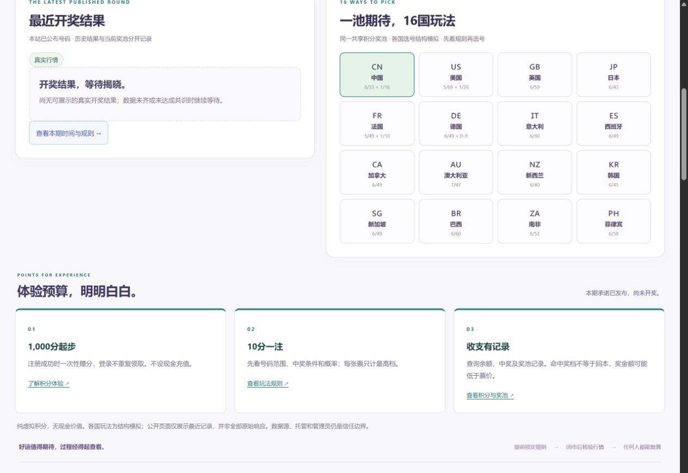

# 首页奖池与开奖结果优化验收

记录日期：2026-10-31（北京时间）。本文记录本轮首页实现、本地验证、正式站及演示站验收。

## 本轮目标

让用户进入首页后更容易找到当前积分池、最近公布的结果和各国玩法，形成对下一期开奖的期待，同时保留积分性质说明、停售与开奖时间和公开核验入口。这里的“吸引力”是页面信息层级与交互设计判断；本轮没有进行真实用户 A/B 测试，也没有测量或宣称注册率、留存率、购买率提升。

## 已实现的设计变化

### 当前积分池靠近首页标题

标题附近增加醒目的共享积分池金额、积分性质说明和账本入口。金额使用更大的数字与等宽数字排版，账本链接保持至少 44px 的可点击高度。原有注册送积分、每注积分和无现金价值说明继续保留，不能让奖池数字遮盖积分的实际用途。

首页当前池金额读取 `state.pool`，明确提示全部玩法共用、虚拟积分、无现金价值。缺少有效奖池数据时显示“—”及不可用说明，不用虚构的 0 或示例大额数字填充。

### 最近开奖结果与当前共享池分开展示

新增“最近开奖结果”卡片，展示符合条件的已公布期次、该期交易日、玩法选择、开奖号码与对应核验链接。当前共享池仍由当前状态提供；历史结果来自该历史期的证明，不拿历史的 `poolBefore`、派奖金额或 `poolAfter` 冒充当前余额。

历史结果的玩法清单取自该期已承诺的 `proof.manifest.games`，避免用后来变化的玩法规则解释旧结果。历史玩法切换只改变所查看的结果，不改变本期选号。

首页展示已公布号码不等于完成密码学复算。用户可进入对应期次的可读核验页，查看规则、数据来源、时间线、证明与复算结果，并继续下载原始 JSON。

### 正式首期保持真实等待状态

正式环境尚无符合条件的真实开奖结果时，结果卡片显示等待说明：“尚无可展示的真实开奖结果；数据未齐或未达成共识时继续等待。”等待状态不展示示例球、假中奖号码或演示结果。

结果展示要求期次已结算、期次与证明清单匹配、模式匹配、玩法目录完整且全部号码符合该期数量与范围。部分结果、无效结果、未确认模式或不匹配证明不作为可展示结果。正式模式不借用 DEMO 结果填补空白。

DEMO 与线上回放使用明确的模式标识和模拟时钟说明；回放不表述为自然时钟触发的真实开奖。已有的停售、数据就绪时间、倒计时和数据源状态继续保留，展示结果不替代开奖条件检查。

### 16 国玩法入口更靠前

“一池期待，16 国玩法”与最近开奖结果并列呈现，移动端改为上下排列。国家按钮展示旗帜、国家名和简短选号结构，并明确这些玩法共用积分池。

点击国家按钮会同步当前玩法、规则说明、选号面板和按钮选中态，清除不适用于新玩法或新期次的旧选号，并将用户带到选号位置。快捷按钮本身不会注册、请求购买或提交彩票；购票仍需在选号区执行明确操作，并遵循现有停售检查。

规则范围尊重各玩法差异，包括特别号的最小值；例如允许 0 的特别号不能被默认的 1 起始范围替代。开放期使用该期已承诺的玩法目录，避免展示规则与实际购票规则不一致。

### 移动端与多语言

新增区域覆盖简体中文、英文、日文，并应用于现有三个首页主题。移动端保留此前的紧凑装饰球与时间、核验入口优先布局，新增积分池采用紧凑卡片。

国家名称支持换行，不采用省略号或固定行数裁切；英文、日文在较窄屏幕减少国家按钮列数。结果下拉框、账本和核验等交互入口保持至少 44px 高度。号码球为非交互展示元素，其尺寸不作为点击目标尺寸计算。开启减少动态效果偏好时，跳转不强制平滑滚动。

## 实现位置与责任边界

| 文件 | 本轮作用 |
| --- | --- |
| `public/index.html` | 标题附近的共享积分池，以及最近开奖结果、各国玩法容器 |
| `public/style.css` | 金额层级、结果卡片、国家按钮、移动端排列与触达尺寸 |
| `public/home-highlights-model.js` | 当前池与历史结果区分、展示资格检查、LIVE / DEMO / REPLAY 状态、历史规则目录 |
| `public/home-highlights.js` | 三语文案、结果与国家按钮渲染、核验和账本入口 |
| `public/app.js` | 首页状态更新、国家快捷入口与原有规则和选号区同步 |

这些新增模块负责首页展示和玩法导航，不改变开奖算法、市场数据共识、派奖或积分账本规则。公平性仍应由已承诺规则、真实数据、账本和公开证明共同核验，页面视觉本身不构成“绝对无法操控”的保证。

## 已完成的本地验收

以下为本轮已完成的本地验证记录，不能替代部署后的线上验收。

| 验证项 | 已完成结果 | 范围说明 |
| --- | --- | --- |
| 单元测试 | 55 项通过，其中本轮新增 12 项 | 包含新增首页展示模型与边界情况 |
| 本地只读检查 | 88 项通过 | 对本地应用执行的只读检查 |
| 布局组合 | 45 组通过 | 5 个视口 × 3 种语言 × 3 个主题 |
| 横向溢出 | 所测 45 组未发现 | 以本轮布局检查覆盖范围为限 |
| 国家文字截断 | 所测 45 组未发现 | 国家名称可换行，无裁切或省略 |
| 交互控件尺寸 | 所检查控件未发现小于 44px 的目标 | 非交互的号码球不属于此项 |

本地验证重点包括：当前池不使用历史余额；正式首期可保持等待；无效或不完整历史结果不生成球；演示和回放模式明确；国家快捷入口只导航与同步选号；语言和主题切换后内容仍可阅读。

## 线上验收与发布

### 部署记录

2026-10-31 发布了 5 个首页静态资源：`index.html`、`style.css`、`app.js` 和两个新增 highlights 模块。没有数据库迁移、密钥变更或开奖逻辑修改。

| 环境 | 地址 | Workers 版本 |
| --- | --- | --- |
| LIVE | [正式站](https://luck.onlinefreetools.org/) | `2ca80c08-95f0-4e0f-8296-bb0a5c2ec843` |
| DEMO | [演示站](https://luck-test.onlinefreetools.org/) | `b2f685b2-2485-4d7d-83d4-286c217272c0` |

### 线上检查结果

| 验证项 | 实际结果 |
| --- | --- |
| 正式站只读脚本 | `TEST_BASE_URL=https://luck.onlinefreetools.org npm run test:readable`，78 项通过，2026-10-31 15:01:41 北京时间 |
| 演示站只读脚本 | 相同命令使用演示站地址，110 项通过，2026-10-31 15:03:06 北京时间；包含 DEMO 历史证明复算 |
| 资源完整性 | 首页 HTML 包含新增入口；首页及核验脚本、模型、样式与本地 SHA-256 相符；原始规则和证明 JSON 接口保留 |
| 正式站布局 | 45 组：320×568、360×740、390×844、430×932、1280×900 × 中英日 × 3 主题，全部通过 |
| 平板补充检查 | 768×1024 × 中英日 × 3 主题，9 组通过，实际 DOM 视口尺寸一致 |
| 可读与可点击 | 无横向溢出、无国家名称或结构文字截断；国家按钮至少 78px 高，奖池账本和结果核验入口至少 44px；模拟结果下拉框至少 44px |
| 16 国导航 | 正式站逐一点击 16 个入口，主玩法、高亮、主球数量、特别球数量及起始值一致，旧选号清空；未选择号码时购票按钮保持禁用 |
| 16 国结果 | 演示站逐一切换 16 种历史结果，主球和特别球逐项等于同一期公开证明；结果选择不改变当前选号玩法 |
| 刷新与语言 | 本地同一期随机选号经刷新保留；切换玩法清空旧选；结果选择经中英切换保留且名称、模式说明正确更新 |
| 浏览器复算入口 | 从演示首页进入 `dfcaa599-5e0f-4678-9e92-6cec97487c11` 的结果核验页，点击重新计算后 7 项一致，状态为“本机复算一致” |

浏览器复算的演示模式检查只验证模拟标记，证明内奖池检查只验证该份证明的算术；它不替代真实双源共识或全账本审计。REPLAY 隔离与提示由模型测试覆盖，本轮没有重新发布或演练回放 Worker。

### 正式期次与积分一致性

发布前后比较，真实期次 `1c6cb4c0-f039-4f23-a290-c303d509562a` 的 manifest、commitment、cutoff 与 ready 均未变化；两次快照的共享奖池均为 101,000 积分，首页金额与公开 `/api/state` 一致。

- 当前状态仍为 `open`、`LIVE`，proof 为 null。
- 最近结果区为 `waiting`，开奖号码球数量为 **0**，没有混入 DEMO 号码。
- 停售为北京时间 2026-11-02 16:30，最早核验为 2026-11-04 05:00。此时首期自然开奖仍在未来，不能宣称已经完成真实派奖。
- 时间与结果核验链接精确指向对应期次，而不是用当前期号代替历史结果期号。

### 排版与首屏范围

桌面压紧重复统计后，1280×900 的三语三主题 hero 均为 560px，最近结果与各国玩法区域从约 741px 开始，900px 高的首屏可见两区标题。桌面奖池金额字号为 44px，使用浅暖底色及金色边框；手机保持紧凑金额行和小球装饰。

390×844 中文默认积分主题中，时间卡核验按钮底部约 663px。360×740、390×844、430×932 的全部语言和主题中，核验入口均在首屏；320×568 短屏需下滑约 103–272px，未为追求首屏而隐藏积分性质、时间解释或缩小点击目标。

国家名称使用国别符号和本地化文字，不依赖系统是否能将区域字母渲染成国旗。结果号码为非交互元素，使用不同颜色区分主球与特别球。

### 开源与持续检查

实现、测试、三语 README 和本报告同步至 [GitHub main](https://github.com/matthewdailytools/market-luck)。具体提交可从[提交历史](https://github.com/matthewdailytools/market-luck/commits/main/)查看。

[Local Cloudflare checks](https://github.com/matthewdailytools/market-luck/actions/workflows/test.yml) 随推送执行单元测试、本地 D1/R2 集成测试、草稿不可见与只读核验检查。各次运行的最终状态以公开 CI 结果为准。

### 截图证据

正式首页的奖池、积分说明与核验入口：

正式站结果等待状态与全部 16 国入口：

手机首屏及真实的演示结果、浏览器复算过程分别见：[手机首页](docs/home-highlights/live-mobile.jpg)、[明确标识的演示结果](docs/home-highlights/demo-results.jpg)、[演示证明本机复算](docs/home-highlights/demo-browser-recheck.jpg)。

本轮已完成首页部署、线上导航、数据对应和布局检查。首期自然开奖及真实派奖仍按原定时间等待，页面的期待感不能替代实际开奖条件。
